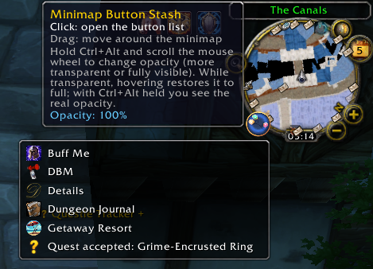

# Minimap Button Stash
[](https://ko-fi.com/M8K423K344)

A World of Warcraft addon for **WoW Forever (Interface 16001)** and **3.3.5a (WotLK,
Interface 30300)** that collects all the round addon buttons around your minimap into
**one** minimap button. Click it to get a simple dropdown list:

```
[icon] Addon name
[icon] Addon name
[icon] Addon name
```



## Features

- **One button instead of many** – addon minimap buttons are hidden from the minimap and
  listed in a single dropdown (icon + addon name, sorted alphabetically).
- **Buttons keep working** – clicking a row triggers the original button (left and right
  click), and hovering a row shows that addon's own tooltip.
- **Finds buttons automatically** – LibDBIcon buttons, plain `Minimap...Button` frames, and
  buttons nested inside container frames (for example Atlas). Buttons created late are
  picked up by a rescan every few seconds.
- **Leaves Blizzard's own elements alone** – zoom buttons, tracking, mail, calendar, clock,
  battleground/LFG eyes and similar are never touched.
- **Works with minimap replacements** such as DragonUI.
- **Movable** – drag the launcher button around the edge of the minimap.
- **Adjustable opacity** – see below.

## Installation

1. Download this repository (**Code → Download ZIP**) or clone it.
2. Copy the **`MinimapButtonStash`** folder (the one containing `MinimapButtonStash.toc`,
   `MinimapButtonStash.lua` and `icon.tga`) into:

   ```
   World of Warcraft\Interface\AddOns\
   ```

   You should end up with `Interface\AddOns\MinimapButtonStash\MinimapButtonStash.toc`.
   Do not copy the whole repository folder, and do not rename the addon folder.
3. Start the game (or `/reload` if it is already running) and make sure the addon is
   enabled on the character select screen's **AddOns** list.

## Usage

| Action | Result |
| --- | --- |
| **Left-click** the launcher | Open / close the button list |
| **Click a row** | Runs the original button's click (left or right) |
| **Hover a row** | Shows the original addon's tooltip |
| **Drag** the launcher | Move it around the minimap edge |
| **Ctrl + Alt + mouse wheel** over the launcher | Change opacity in 10% steps (10% – 100%) |
| **Esc** or click elsewhere | Close the list |

### Opacity

Hold **Ctrl + Alt** while scrolling the mouse wheel over the launcher to make it more
transparent or fully visible. When it is transparent, hovering over it restores it to full
opacity so it is easy to use. While **Ctrl + Alt** is held, the real opacity is shown even
under the mouse so you can see how much you are changing it. The current value is shown
in the tooltip, and the setting is saved between sessions.

### Slash commands

| Command | Description |
| --- | --- |
| `/mbs` | Rescan and print how many buttons were found |
| `/mbs list` | Print every stashed button with its frame name |
| `/mbs show` | Put all buttons back on the minimap (until `/reload`) |
| `/mbs hide` | Stash the buttons again |
| `/mbs reset` | Reset launcher position and opacity |

## Troubleshooting

- **A button is missing from the list** – run `/mbs list` to see what was found. For a
  button that isn't detected, find its frame name with `/fstack` (hover the button) and
  open an issue with that name and the addon it belongs to.
- **A name looks odd or says "Unknown"** – names are taken from the addon's button (LibDBIcon
  addons provide a proper label); otherwise they are derived from the frame name.
- **The launcher is in an awkward place** – `/mbs reset`.

## Compatibility

- **WoW Forever** client (Interface `16001`). If your client reports a different number,
  check it with `/dump select(4, GetBuildInfo())` and edit the `## Interface:` line in the
  `.toc`, or enable "Load out of date AddOns" on the character select screen.
- **3.3.5a** client (Interface `30300`) still works: change the `.toc` Interface line to `30300`.
- No libraries are required.

## Saved variables

`MinimapButtonStashDB` stores the launcher angle (`angle`) and opacity (`alpha`).

## Contributing

Bug reports and pull requests are welcome – please include the addon name and its frame
name (`/fstack`) when reporting a button that isn't picked up.
